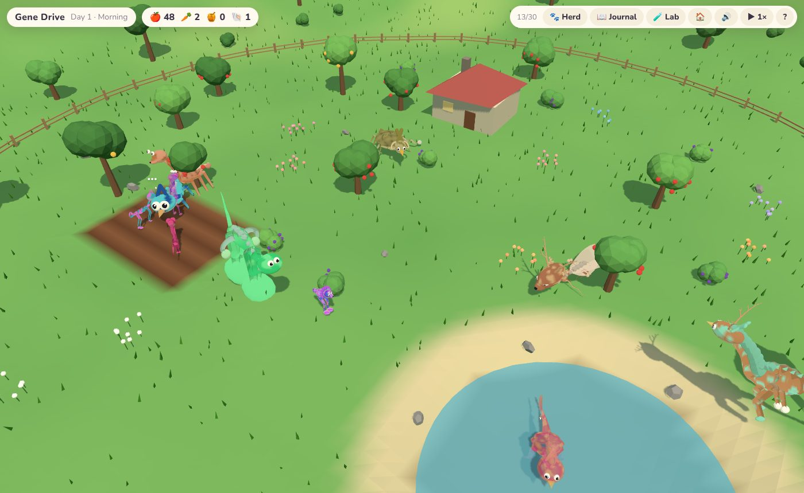
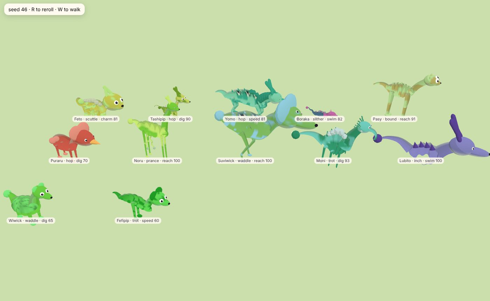

# Gene Drive 🧬

A cozy 3D creature ranch. Every creature is grown from its genome, its body
decides what it can do, and new forms appear through breeding and mutation.
Inspired by the creature creator in *Spore*.

- **Breed** two creatures and watch their genes mix. The partner list shows the
  odds for their babies. Wings, glow, shells and second heads are recessive, so
  two plain parents can surprise you.
- **Truly odd shapes:** size, lumpy bodies, trunks, tusks, antlers, eye stalks,
  tentacles, shells, sails, and *sprouts*: extra parts whose genes can copy
  themselves or vanish from one generation to the next.
- **Personality:** ten gaits (hop, waddle, slither, scuttle, inchworm…),
  procedural voices, and a signature quirk for every creature.
- **Form follows function:** long necks reach high fruit, big feet dig roots,
  tails and fins swim, and wings that are big enough let a creature fly.
- **Wild visitors** wander in carrying new genes. Welcome them before they leave.
- **Fill the Journal** with discoveries to unlock sliders in the **Creature Lab**.



Built with [three.js](https://threejs.org/), TypeScript and Vite. All creatures,
terrain, scenery and sounds are procedural: there are no art or audio assets.

## Play

Once GitHub Pages is enabled (see below), the game is published from `main` to
`https://smaclell.github.io/gene-drive/`. The creature gallery is at
`/gallery.html`.



Locally:

```bash
npm install
npm run dev
```

**Controls:** drag to move around, right-drag or `Q`/`E` to turn, scroll or pinch
to zoom, `WASD` or arrow keys to pan, `Home` to recentre. Click a creature to say
hi and inspect it. Shortcuts: `B` breed, `F` follow, `H` herd, `J` journal,
`L` lab, `Esc` deselect.

The creature gallery takes tuning parameters, e.g.
`gallery.html?walk=1&set=legPairs:0.05` (walking legless creatures) or
`gallery.html?theme=curio&sprouts=2`.

## Publishing to GitHub Pages

1. In the repo, go to **Settings → Pages → Build and deployment** and set **Source** to **GitHub Actions**.
2. Push to `main`. The *Deploy to GitHub Pages* workflow builds and publishes the site.

GitHub Pages for a **private** repository needs a paid GitHub plan. On a free
plan, make the repository public, or host `dist/` elsewhere (Netlify,
Cloudflare Pages and Vercel all deploy private repos for free).

## Docs

- [`docs/DESIGN.md`](docs/DESIGN.md): vision, genetics and systems
- [`docs/ROADMAP.md`](docs/ROADMAP.md): what's built and what's next
- [`CLAUDE.md`](CLAUDE.md): architecture and conventions for contributors and AI sessions
